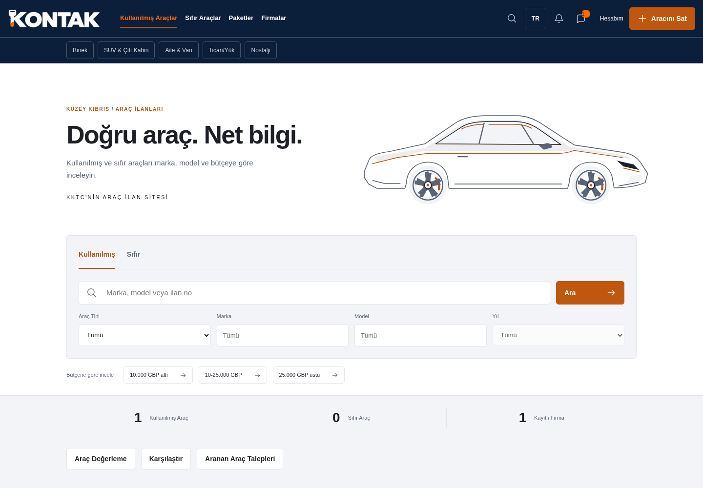
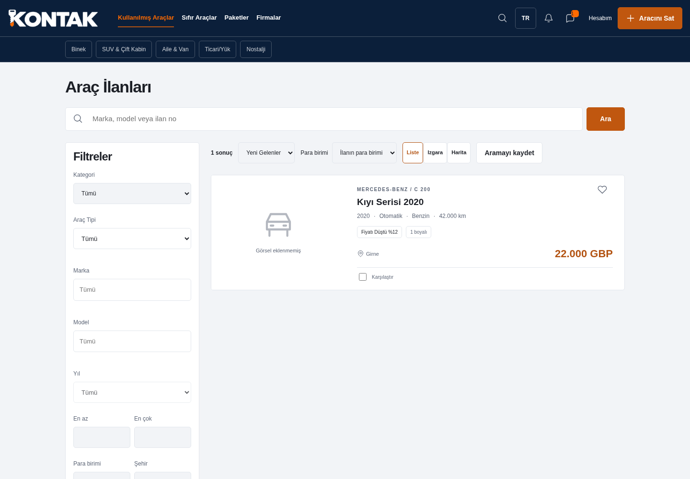
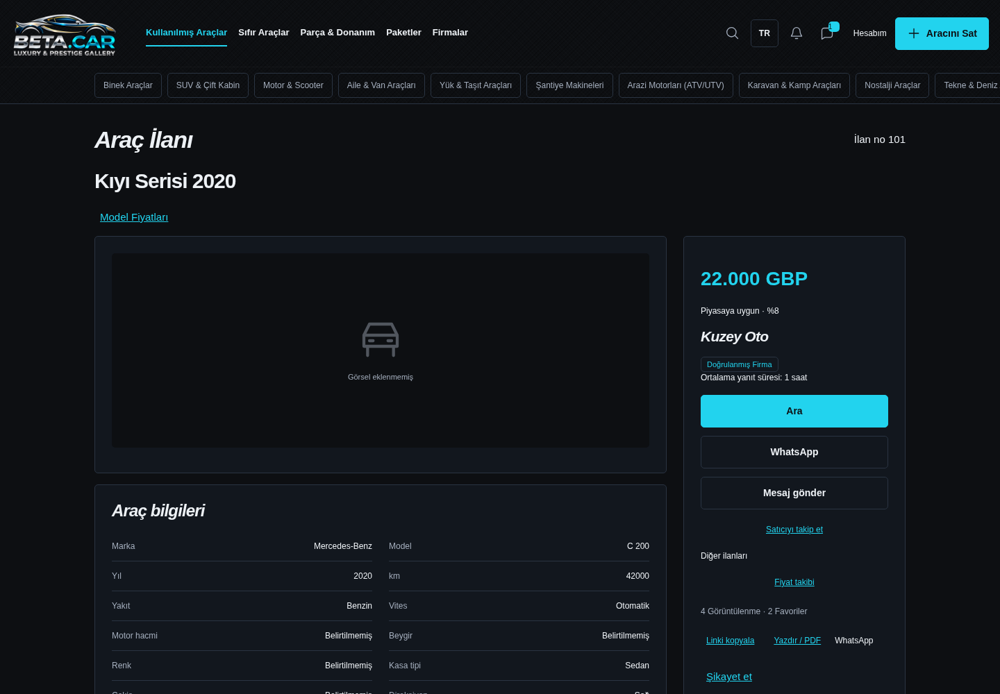
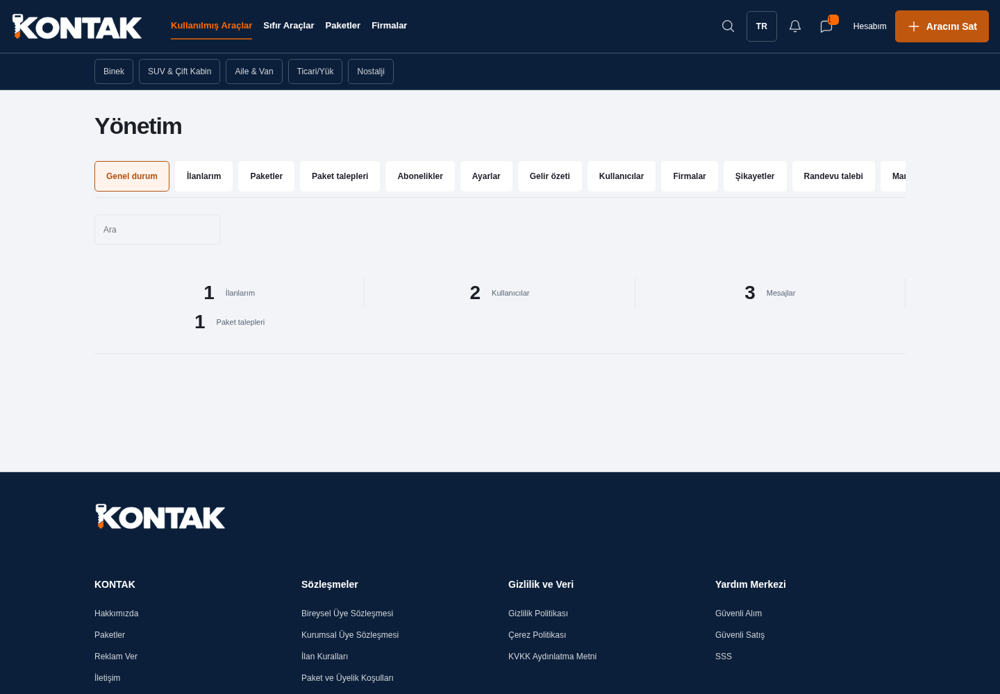

# BETA.CAR

BETA.CAR, Kuzey Kıbrıs için araç ve parça ilan platformudur. Kullanılmış araç, sıfır araç ve parça ilanlarını bireysel ve kurumsal satıcılarla bir araya getirir. Marka sloganı: **Luxury & Prestige Gallery**.

[Siteyi aç](https://beta-car.vercel.app) · [Yayın kaydı](docs/firebase-yayin.md)

## Özellikler

- İlan arama, ayrıntılı filtreler, ilçe düzeyinde harita, kaporta ve donanım bilgileri
- Bireysel ve kurumsal üyelik, favoriler, kayıtlı aramalar ve bildirimler
- Site dışında havale ile yürütülen paket talebi, özel dekont, kota ve süre yönetimi
- Firma sayfaları, site içi mesajlaşma, araç karşılaştırma ve piyasa verisine dayalı değerleme
- Yönetim paneli, içerik ve şikâyet yönetimi, Türkçe ve İngilizce arayüz

## Mimari

```text
Tarayıcı: HTML + CSS + ES modülleri + Firebase Web SDK
    │ Firebase Auth kimliği · /api · Storage · onSnapshot
    ▼
Cloud Functions → Firestore Standard / Cloud Storage / bildirim kuyruğu
Cloud Scheduler → süre, kota ve bildirim bakımı
Firebase Hosting → seo işlevi → açık sayfa HTML'i ve sitemap

GitHub → Firebase CLI → Firebase Hosting (.build)
```

Kota, abonelik ve yetki denetimleri sunucuda Firestore transaction işlemleriyle yürütülür. İstemci rol veya kota belirlemez. Firebase Web SDK `13.0.0` sürümüne sabitlenmiştir; arayüz framework'ü bulunmaz.

## Dosya düzeni

```text
*.html, style.css, app.js, logo.png
js/                 Ortak yardımcılar ve sözlük
js/pages/           Sayfa modülleri
scripts/            Statik build, yerel sunucu ve ekran görüntüsü betikleri
tests/              Saf fonksiyon, veritabanı ve tarayıcı testleri
functions/          Sunucu işlemleri ve başlangıç verileri
firestore.rules     Firestore erişim kuralları
storage.rules       Dosya erişim kuralları
supabase/           Korunan eski SQL kurulumu
docs/               Kurulum, inceleme, yayın ve kabul belgeleri
```

## Yerel çalıştırma

Node.js 22+ ve Java 21+ gerekir.

```bash
npm ci
npm ci --prefix functions
npx playwright install chromium
npm run firebase:emulators
```

Site `http://127.0.0.1:5000`, emülatör paneli `http://127.0.0.1:4000` adresindedir. Yerel `demo-beta-car` projesi canlı servise bağlanmaz. Yalnız arayüz için `npm run dev` kullanılır. `npm run format` biçimi düzenler.

## Ortam ayarları

Kaynak `js/config.js` bağlantı alanları boş kalır. Firebase Hosting public web yapılandırmasını kendi ayrılmış adresinden sağlar. Farklı statik sunucuda build için `FIREBASE_WEB_CONFIG` kullanılabilir; service account ve özel sunucu kimlikleri kabul edilmez. `.env*`, kimlik dosyaları, `seed.js` ve `.seed-state.json` Git dışındadır.

Kurulum, ilk yönetici, paket/banka ayarları, SMS ve bildirim e-postaları [kurulum belgesinde](docs/kurulum.md) açıklanır. Eski SQL dosyaları korunur; Firebase'de uygulanmaz. Canlı veri aktarımı ayrıca planlanır.

## Test

```bash
npm run lint
npm test
npm run test:firebase
npm run test:browser
npm run build
```

Saf fonksiyonlar ve korunan SQL için birim/regresyon testleri bulunur. Firebase testleri Auth, Firestore, Storage ve Functions emülatörlerinde yetki, kota, paket, mesaj ve dosya kurallarını doğrular. Arayüz testleri servis yanıtlarını taklit eder. `CHROMIUM_PATH` isteğe bağlıdır; sabit sistem yolu yoktur. CI aynı kontrolleri push ve pull request'te çalıştırır.

## Dağıtım

```bash
npx firebase login --no-localhost
npm run firebase:deploy
```

Yayın betiği hesap erişimini denetler, gerekirse proje ve web uygulaması açar, veritabanını hazırlar ve Firebase bileşenlerini yayımlar. Betik Storage alanını da hazırlar; gerekli hesap ve faturalandırma onayları Google hesabında tamamlanır. İstemci çıktısına sunucu, test, belge veya kimlik dosyası girmez. Proje ve servislerin durumu [Firebase yayın kaydında](docs/firebase-yayin.md) yer alır. Ayrıntılar [kurulum](docs/kurulum.md), [yayın kontrol listesi](docs/yayin-kontrol-listesi.md) ve [kabul testlerinde](docs/kabul-testleri.md) yer alır.

## Güvenlik

Tüm istemci veritabanı yazmaları kapalıdır. Sunucu her istekte Auth hesabını, özel rolü, sahipliği, alan/tür/uzunluk sınırlarını ve hız sınırlarını kontrol eder. Dekont ve ekspertiz yolları özeldir; izinli görüntüleme bağlantıları 120 saniyede sona erer. IBAN yalnız sahibinin ödeme bekleyen talebinde açılır. Site tahsilat yapmaz, kapora toplamaz.

CSP satır içi script ve stilleri engeller. HSTS, frame-ancestors ve diğer güvenlik başlıkları Firebase Hosting'de tanımlıdır. [Güvenlik incelemesi](docs/firebase-guvenlik.md), [bildirim kanalı](SECURITY.md) ve [istemci bağımlılıkları](docs/istemci-bagimliliklari.md) incelenebilir.

## SEO

Açık sayfalar sunucudan taranabilir HTML, canonical, TR/EN dil bağlantıları ve paylaşım etiketleri alır. Dinamik sitemap yayındaki kayıtları içerir; özel sayfalar indeks dışındadır. Yapılandırılmış veri, canlı kontrol sonuçları ve Search Console adımları [SEO belgesinde](docs/seo.md) yer alır.

## Ekran görüntüleri

Görüntüler kurmaca test kayıtlarıyla alınmıştır; canlı kişi, dekont veya banka verisi içermez. Yenilemek için `npm run screenshots` çalıştırılır.

| Ana sayfa                            | İlan listesi                               |
| ------------------------------------ | ------------------------------------------ |
|  |  |

| İlan detayı                              | Yönetim paneli                                 |
| ---------------------------------------- | ---------------------------------------------- |
|  |  |

## Lisans

Tüm hakları saklıdır. © 2026 Yusuf Basaran. Kullanım koşulları [LICENSE](LICENSE) dosyasındadır. Üçüncü taraf bileşenlerin lisansları kendi koşullarına tabidir.
